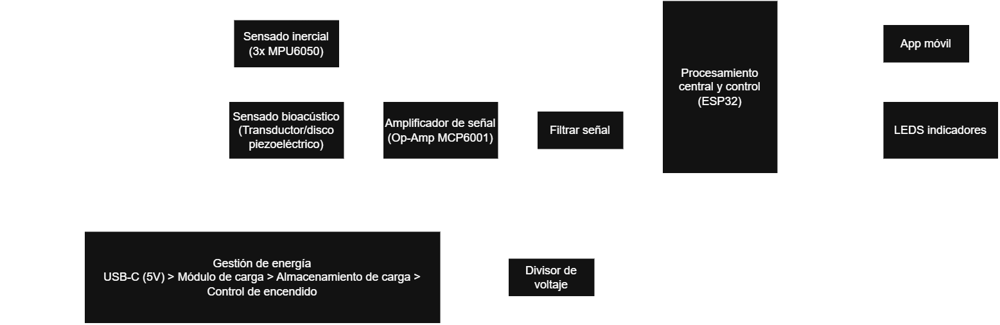

# System Block Diagram

## Overview

This section presents the functional block diagram of a non-invasive biomedical device designed to detect and monitor fetal movements and fetal heart rate using piezoelectric sensors.

## Block Diagram

## Project Status

Finished
